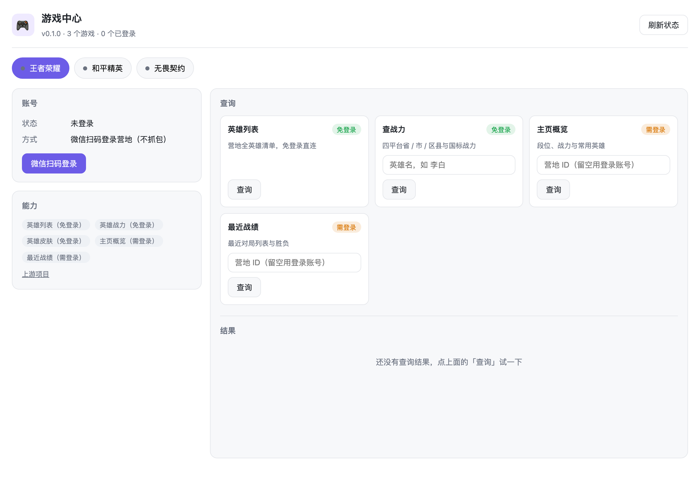
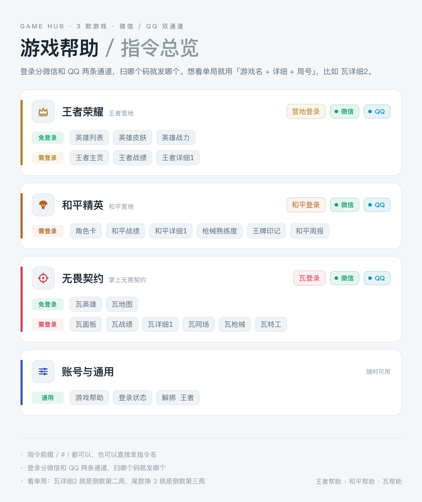
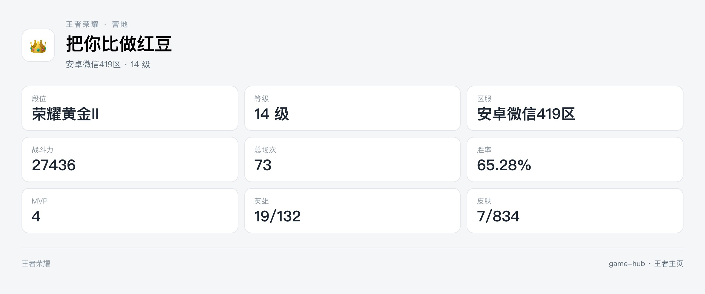
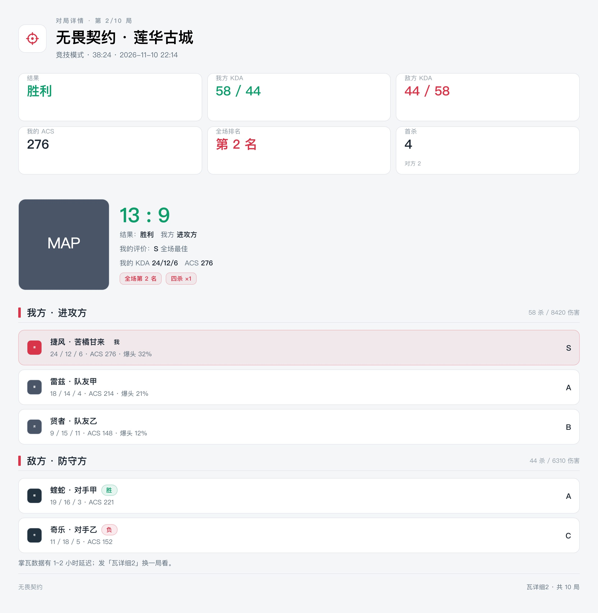
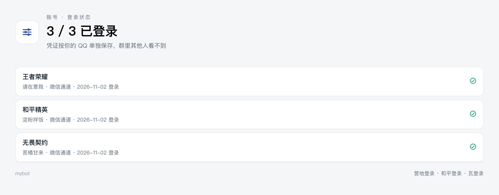
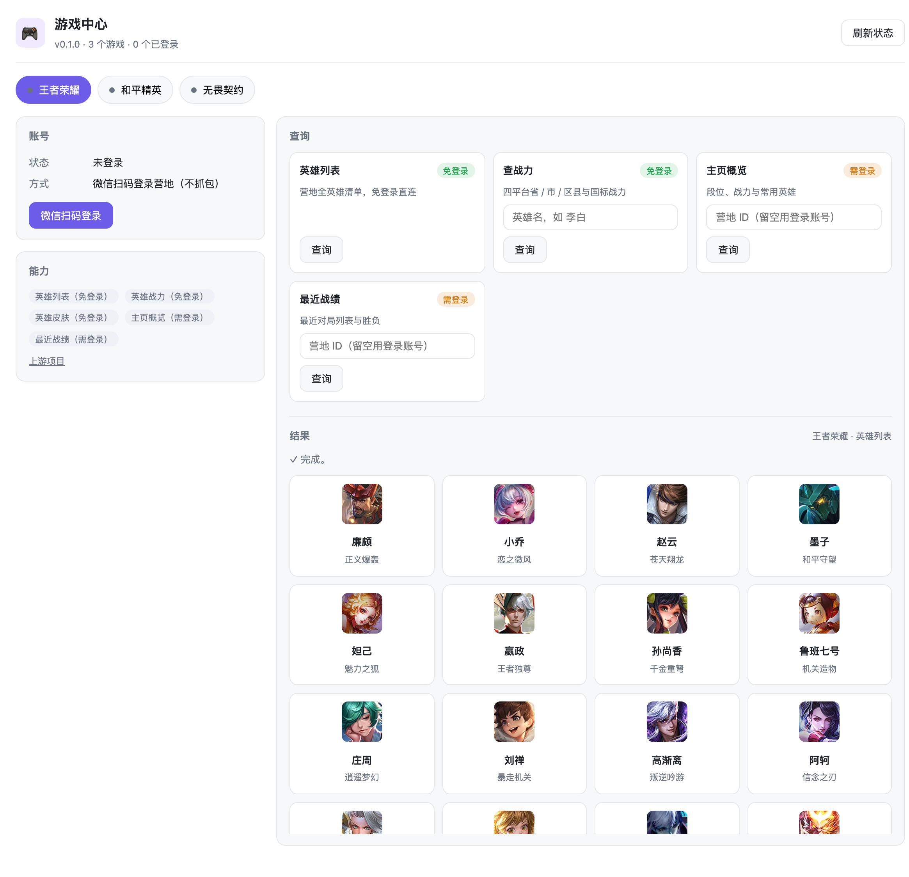
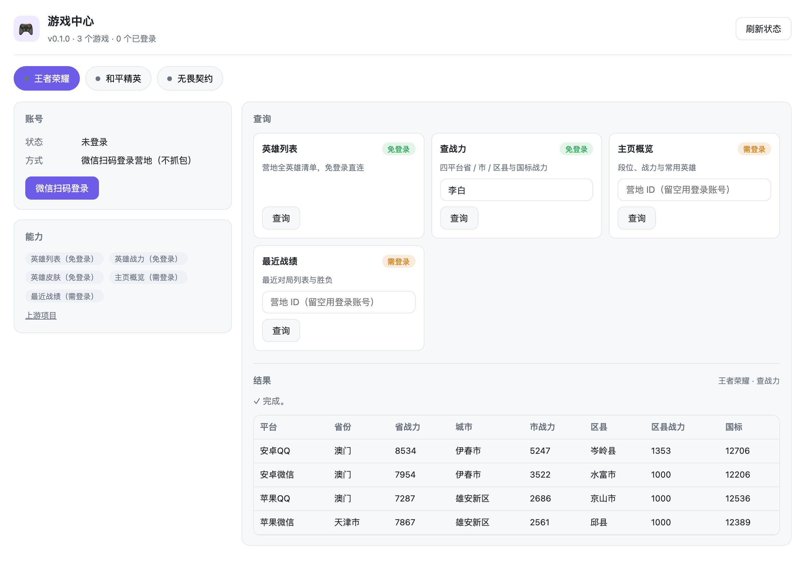
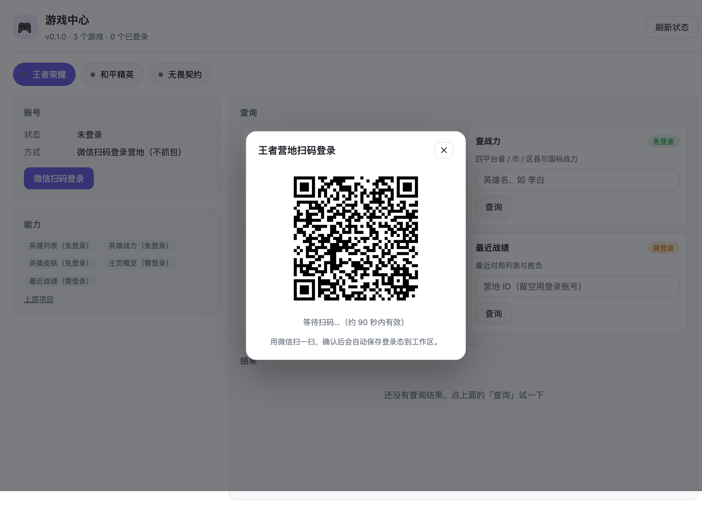
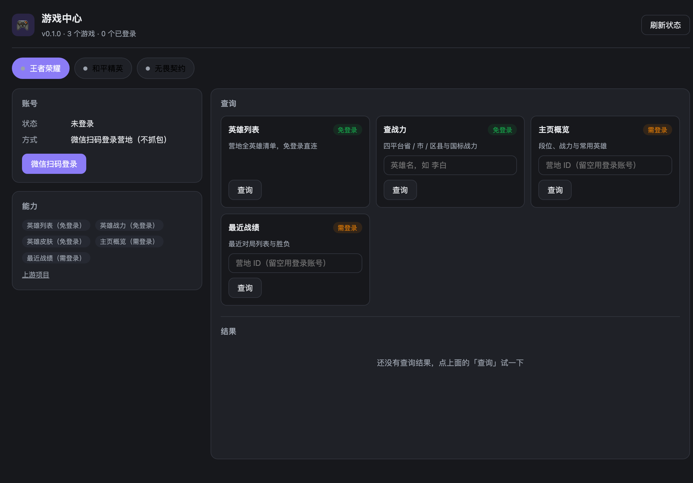

# 游戏中心 · game-hub

把**王者荣耀**、**和平精英**、**无畏契约**三款游戏的扫码登录与数据查询收进一个插件：
放进 [ALemonX](https://github.com/lemonade-lab/alemonx) 工作台是侧栏面板，配 `bot/` 里的示例机器人在 QQ 群里是「指令 + 卡片出图」。

微信 / QQ 双通道扫码登录，不抓包、不装证书；公开数据（英雄、地图、战力）免登录直接查。



## 适配框架

| 层 | 依赖 | 说明 |
| --- | --- | --- |
| 工作台插件 | [ALemonX](https://github.com/lemonade-lab/alemonx) | `alx.json` 清单，放进 `workspace/plugins/` 热发现，宿主按 `alx/v1` 协议调用 `runner/main.mjs`。插件本体零 npm 依赖 |
| 群聊机器人 | [AlemonJS](https://alemonjs.com) 2.x | `bot/` 是一个标准 AlemonJS 工程（`@alemonjs/onebot`），路由 / 消息 / 主动推送都用框架能力 |
| QQ 协议端 | OneBot v11（[NapCat](https://github.com/NapNeko/NapCatQQ)） | 反向 WebSocket 连到机器人的 17258 端口 |
| 卡片出图 | 本机 Chrome / Edge | `puppeteer-core` 直连已装浏览器，不下载 Chromium、无外部字体与 CDN 请求 |

两个消费端共用同一份适配器和账号库：**面板里登录过的账号，群里直接能查**，反过来同理。

## 机器人出图（bot/）

所有指令的回复都是渲染好的图片（1180px 宽 JPEG），版式遵循 [docs/出图UI设计规范.md](docs/出图UI设计规范.md)：
亮色底 + 纯白卡片 + 1px 边框，零光效、零渐变、零颜色字面量，全部走 CSS 变量；
徽标与状态图标是内联 SVG，跟主题色联动。

<table>
<tr>
<td width="50%"></td>
<td width="50%"></td>
</tr>
<tr>
<td width="50%"></td>
<td width="50%"></td>
</tr>
</table>

## 参考插件

本项目把三款游戏的**数据适配与扫码登录**收敛成一套统一接口，按各自许可证在 [THIRD-PARTY-NOTICES.md](THIRD-PARTY-NOTICES.md) 逐文件列明来源与改动：

| 参考项目 | 作者 | 许可证 | 本项目怎么用 |
| --- | --- | --- | --- |
| [Valorant-Plugin](https://github.com/Looking08/Valorant-Plugin) | Looking08 | MIT | 掌瓦扫码链路（get_sdk_ticket → qrconnect → login_by_wechat）与出图 UI 规范按其公开思路重写，未复制代码 |
| [PUBG-Helper-Plugin](https://github.com/TciFurh/PUBG-Helper-Plugin) | TciFurh | MulanPSL-2.0 | 微信扫码登录模块 `runner/vendor/pubg/wxQrLogin.js` 原样引入（仅改 import） |
| [GloryOfKings-Plugin](https://gitee.com/Tloml-Starry/GloryOfKings-Plugin) | 小丞 | MIT | 营地接口加密 / XXTEA 解密 / 微信登录 `runner/vendor/kog/` 原样引入（仅改 import） |

数据全部来自各游戏官方营地 / 掌瓦接口与 valorant-api.com 公开数据集，版权归各自权利人；本项目只做客户端侧调用。

## 能力一览

| 游戏 | 免登录 | 需登录 | 登录方式 |
| --- | --- | --- | --- |
| 王者荣耀 | 英雄列表、英雄战力、英雄皮肤 | 主页概览、最近战绩、对局详情 | 微信 / QQ 扫码登录「王者营地」 |
| 和平精英 | — | 角色卡、最近战绩、对局详情 | 微信 / QQ 扫码登录「和平营地」 |
| 无畏契约 | 英雄资料、地图列表 | 个人面板、最近战绩、对局详情 | 微信 / QQ 扫码登录「掌上无畏契约」 |

> 微信区账号扫微信码，QQ 区账号扫 QQ 码。两条通道各自独立，同一个群里互不干扰。

<table>
<tr>
<td width="50%"></td>
<td width="50%"></td>
</tr>
</table>

## 安装

**方式一：插件市场（推荐）**

在 ALemonX 的「插件」页搜索「游戏中心」安装。安装后侧栏出现 🎮 入口。

**方式二：手动解压**

把发布包解到工作区插件目录，宿主会热发现，不用重启：

```bash
unzip game-hub-<os>-<arch>.zip -d <workspace>/plugins/
# 结果：<workspace>/plugins/game-hub/alx.json
```

**方式三：源码直挂**

```bash
git clone https://github.com/Looking08/alemonx-game-hub <workspace>/plugins/game-hub
```

> 仓库里带 `bot/` 示例机器人与 `docs/` 截图，`alx.json` 在仓库根目录，
> 宿主只认根目录的清单，其余目录不影响插件装载。

插件没有第三方依赖，不需要 `npm install`。

## 使用

1. 打开侧栏「游戏中心」，选游戏标签页；
2. 点「微信扫码登录」或「QQ扫码登录」，用对应的 App 扫弹窗里的码，手机上点确认；
3. 登录成功后账号卡显示昵称、营地 ID 与登录渠道，需要登录的查询自动可用。



暗色主题跟随宿主：面板读 `?theme=dark|light`，也会回落到系统偏好。



## 在 QQ 群里用（不是面板扫码）

面板扫码只解决「管理员自己查自己」。要让**群里的每个人**都能用，口令侧接一套指令：
二维码直接发进群，谁发的指令就用谁扫的号，凭证按 QQ 分开存。

指令侧就是本仓库的 `bot/`（一个标准 AlemonJS 工程）：`src/game/hub.mjs` 动态 import
本插件的 `runner/games/*.mjs`，并共用同一个 `ALX_PLUGIN_STORE`，所以**面板里登录过的账号，
群里也能直接查**，反过来同理。

启动机器人：

```bash
# 前提：插件已按上面任意一种方式放进 <workspace>/plugins/game-hub
cd bot
yarn install            # 只有 alemonjs / @alemonjs/onebot / jsxp 几个依赖
# 改 alemon.config.yaml：master_id 填你自己的 QQ 号
sh run.sh               # 应用服务器 17119，OneBot 反向 WS 监听 17258
```

再把 NapCat 的反向 WebSocket 指到 `ws://<本机>:17258`（OneBot v11）即可。
机器人需要本机装有 Chrome 或 Edge（出图用），首次查询会自动下载英雄 / 地图素材并缓存。

| 游戏 | 微信通道 | QQ 通道 | 免登录查询 | 需登录查询 |
| --- | --- | --- | --- | --- |
| 王者荣耀 | `营地登录 微信` | `营地登录 QQ` | `英雄列表 [关键词]`、`英雄战力 李白` | `王者主页`、`王者战绩`、`王者详细1` |
| 和平精英 | `和平登录 微信` | `和平登录 QQ` | — | `角色卡`、`和平战绩`、`和平详细1`、`枪械熟练度`、`王牌印记`、`和平周报` |
| 无畏契约 | `瓦登录 微信` | `瓦登录 QQ` | `瓦英雄 [关键词]`、`瓦地图` | `瓦面板`、`瓦战绩`、`瓦详细1`、`瓦同场`、`瓦枪械`、`瓦特工` |
| 通用 | — | — | `游戏帮助`、`登录状态`、`解绑 王者` | — |

不带参数时默认走微信；也可以把渠道写进指令名（`瓦QQ登录`、`和平QQ登录`、`营地QQ登录`）。

**对局详情** 是「游戏名 + 详细 + 第几局」连写：`瓦详细1`、`王者详细2`、`和平详细3`，
尾数就是第几局（1 = 最近一局，2 = 倒数第二局），支持 1~12；不写数字默认第 1 局。
兼容写法：`瓦详细 详情`（详细 / 详情同义）、`无畏详细1` / `掌瓦详细1` / `王者荣耀详细2` / `和平精英详细3`，
旧指令 `对局详情 瓦 1` 也仍然认。

流程：发 `营地登录 QQ` → 机器人在群里发 QQ 二维码 → 手机 QQ 扫码确认 → 机器人回「登录成功」
之后就能直接查。指令默认带 `/ # !` 前缀也行，裸指令也行。

要点：

- 用户维度是 `qq:<QQ号>`，多人在同一个群各登各的互不串号；
- 扫码结果用主动消息推回原会话（群聊 → `message.send.channel`，私聊 → `message.send.user`），
  所以指令不会卡住 100 秒；
- `解绑 王者` 只删自己名下的凭证。


## 扫码链路

两条通道：**微信**（微信开放平台的扫码 SDK）和 **QQ**（QQ 互联的 `ptqrshow` 扫码）。

### 微信

三条链路本质是同一条微信「扫码 SDK」流程，只是 `appid` 和换票接口不同：

```text
取票（sdk_ticket）
   ↓
open.weixin.qq.com/connect/sdk/qrconnect  → 拿到 uuid + 二维码图
   ↓
long.open.weixin.qq.com/connect/l/qrconnect?uuid=...   ← 长轮询
   ↓ 405 + wx_code（已扫码并确认）
换取登录态（各游戏自己的接口）
```

| 游戏 | 取票接口 | 换登录态 |
| --- | --- | --- |
| 王者荣耀 | 营地 `get_sdk_ticket` | `kohcamp` 登录后取 userKey（RSA 分块加密 + XXTEA 解密响应） |
| 和平精英 | 营地 `get_sdk_ticket` | `formal.api.gp.qq.com` 绑定 openid |
| 无畏契约 | `app.mval.qq.com/go/auth/get_sdk_ticket` | `/go/auth/login_by_wechat` |

### QQ

```text
xlogin（appid=716027609，pt_3rd_aid 按游戏取）
   ↓
xui.ptlogin2.qq.com/ssl/ptqrshow?s=8     → 296×296 二维码
   ↓
xui.ptlogin2.qq.com/ssl/ptqrlogin         ← 轮询 ptuiCB（66 未扫 / 67 待确认 / 0 成功 / 65 失效）
   ↓ 0 + check_sig 地址
check_sig 追 302 → auth://tauth.qq.com/#access_token=…&openid=…
   ↓
换取登录态（各游戏自己的接口）
```

`pt_3rd_aid` 各游戏不同（掌瓦 `102061775`、和平营地 `1105412664`、王者营地 `1104466820`），
openid 是按它签发的 —— 填错的症状不是报错，而是最后一步「营地/掌瓦不认这个 openid」。

`ptqrshow` 不校验 `pt_3rd_aid`，随便填也回图，所以调参时别拿「有没有图」当判断依据。

`check_sig` 的官方落点主机（`ptlogin4.openmobile.qq.com` / `ptlogin4.graph.qq.com` /
`ptlogin4.web.qq.com`）在 2026-10 起被解析到 `0.0.0.1`，所以代码会把同一段 path/query
换到 `ptlogin4.qq.com` 等还活着的主机重试；全失败时把每一跳的结果带回给用户。

因为宿主是「一次动作 = 一个独立进程」，扫码被拆成两个动作：

- `login.start`：出码，返回 base64 二维码，并把会话写进 `session.json`
  （`channel` 字段记录走的是 `wx` 还是 `qq`，QQ 会话里还带着 `cookies / qrsig / ptqrtoken`）；
- `login.await`：单个阻塞动作，内部轮询最多 90 秒，期间通过 stderr 发
  `@alx-progress` 进度帧（等待扫码 → 已扫码 → 完成）。

## 动作清单

面板通过 `POST /api/v1/setup/plugins/game-hub/actions` 调用，全部是普通动作
（未使用 `statusActions`，因为状态动作不允许带参数，而这里需要按游戏判定登录态）。

| 动作 | 参数 | 说明 |
| --- | --- | --- |
| `status` | — | 三个适配器的装载状态、登录状态、账号摘要（含 `loginChannels` 与已登录渠道） |
| `login.start` | `game`、`channel`（`wx`\|`qq`，默认 `wx`） | 生成对应渠道的二维码 |
| `login.await` | — | 阻塞等待扫码，最长 90 秒 |
| `account.remove` | `game` | 删除本地凭证 |
| `kog.heroes` | — | 营地全英雄 |
| `kog.power` | `hero` | 按英雄名查四平台省/市/区县/国标战力 |
| `kog.profile` | `id` | 主页概览（留空用登录账号） |
| `kog.matches` | `id` | 最近战绩 |
| `kog.battleDetail` | `index` | 单局详情（第几局，默认最近一局） |
| `kog.skins` | `hero` | 英雄皮肤 |
| `pubg.profile` | — | 角色卡 |
| `pubg.recent` | — | 最近战绩 |
| `pubg.battleDetail` | `index` | 单局详情 |
| `pubg.weapons` / `pubg.honor` / `pubg.weekly` | — | 枪械熟练度 / 王牌印记 / 周报 |
| `val.agents` | — | 特工资料 |
| `val.maps` | — | 地图列表 |
| `val.panel` | — | 个人面板：段位、赛季最高、胜率、ACS、最近 10 局 |
| `val.matchDetail` | `index` | 单局详情（十人数据 + 地图 + 比分） |
| `val.peers` | `index` | 同场玩家 |
| `val.weapons` / `val.agentsPerf` / `val.mapsPerf` | `sort` / — / — | 枪械 / 特工 / 地图熟练度 |

返回结构统一为 `{ output, data }`，失败时带 `error`。

## 数据与隐私

- 凭证落在宿主注入的 `ALX_PLUGIN_STORE`（`<workspace>/store/game-hub/`），
  升级插件不会清空；
- `accounts.json` / `session.json` 权限 `0600`，目录 `0700`；
- 二维码会话是短时的，过期即删；未扫码成功不会留下任何账号数据；
- 插件不上报任何数据，除上述游戏官方接口与 `valorant-api.com` 外不发起网络请求；
- 微信登录态等价于账号凭证，**不要**把 `store/game-hub/` 提交到仓库或分享出去。

## 项目结构

```text
game-hub/
├── alx.json                  # 插件清单
├── bot/                      # 示例机器人：QQ 群指令 + 卡片出图（AlemonJS 工程）
│   ├── src/game/             # 路由 / 登录 / 查询 / 卡片模型 / 菜单 / 渲染
│   ├── scripts/              # 自测、量高、版式预览脚本
│   ├── run.sh                # 启动入口（会剥掉 IDE 注入的环境变量）
│   └── alemon.config.yaml    # OneBot 反向 WS、主人账号等配置
├── docs/                     # 截图与出图 UI 设计规范
├── web/                      # 面板（原生 HTML/CSS/JS，无构建）
│   ├── index.html
│   ├── app.js
│   └── style.css
├── runner/
│   ├── main.mjs              # 协议入口与动作路由
│   ├── lib/
│   │   ├── store.mjs         # ALX_PLUGIN_STORE 读写
│   │   ├── dataurl.mjs       # base64 → data URL（按魔数嗅探 JPEG/PNG）
│   │   ├── fetch.mjs         # node-fetch 兼容层（timeout → AbortSignal）
│   │   ├── alx-shim.mjs      # 替代云崽的 #components / logger
│   │   └── alx-authstore.mjs # 替代上游 authStore
│   ├── games/
│   │   ├── kog.mjs
│   │   ├── pubg.mjs
│   │   └── val.mjs
│   └── vendor/               # 上游代码原样引入，见 THIRD-PARTY-NOTICES.md
└── scripts/package.mjs       # 打包发布
```

## 开发与联调

**不启宿主直接跑执行器**，用一条 JSON 喂进去：

```bash
echo '{"protocol":"alx/v1","method":"run","action":"kog.heroes","params":{}}' \
  | ALX_PLUGIN_STORE=/tmp/gh-store node runner/main.mjs
```

**在宿主里看面板**（插件放进 workspace 后热重载）：

```text
http://127.0.0.1:17390/api/v1/setup/plugins/web/game-hub/index.html
```

**面板调样式**时加 `?demo=1` 用内置样例数据渲染，不请求宿主；
`&action=<动作名>` 可指定预填哪个查询结果，`&theme=dark` 切暗色：

```text
.../index.html?demo=1&action=kog.power&theme=dark
```

### 联调清单

- [x] `status` / `kog.heroes` / `kog.power` / `val.agents` / `val.maps` 在真实宿主里跑通
- [x] 三个游戏的 `login.start` 都能拿到真实微信二维码
- [x] 三个游戏的扫码**确认后**换票（真机微信实测通过）
- [x] `kog.profile`（角色/段位/战斗力/胜率）与 `kog.matches` 实测通过
- [x] `pubg.profile` 角色卡实测通过（`rolecard3` 要 **POST 表单** + `friendUserId` 填营地 ID）
- [x] `val.panel` 掌瓦个人面板实测通过（`cookie` 的 `access_token` 位填 `wt`）
- [ ] `pubg.recent`：接口已通，测试号近期无对局，待有战绩时再看排版
- [ ] `kog.matches`：测试号关闭了战绩展示，返回空列表属正常
- [x] 聊天侧指令（`mybot`）跑通：群内扫码登录 + 三游戏查询按 QQ 隔离

## 打包与发布

版本号只改 `alx.json` 的 `version`，执行器从清单读取，不会两处漂移。

```bash
node scripts/package.mjs                      # 所有平台
node scripts/package.mjs darwin-arm64         # 只打一个平台
```

产物在 `dist/`，命名与官方插件一致（宿主按这个规则找资产）：

```text
game-hub-darwin-amd64.zip
game-hub-darwin-arm64.zip
game-hub-linux-amd64.zip
game-hub-linux-arm64.zip
...
SHA256SUMS
```

zip 里是单层 `game-hub/` 目录，含 `alx.json`、`web/`、`runner/`、许可证文件。

发布：

```bash
gh release create v0.1.0 dist/* --title v0.1.0 --notes "首个版本：三游戏扫码登录与数据查询"
```

tag 必须是 `v<version>` 形式，宿主用 `alx plugin install game-hub 0.1.0 <asset>` 安装。

> 因为执行器是 `.mjs`，同一个包在所有平台通用；仍按平台分别产资产，是为了匹配宿主的
> 「按平台选资产」逻辑。

## 上架插件市场

市场的 Setup 插件列表来自资源平台 `open.alemonjs.com` 的 `x-plugin` 资源：

```bash
curl "https://open.alemonjs.com/api/v2/resources?type=x-plugin&pageSize=100"
```

提交流程：

1. 仓库推到公开的 GitHub 仓库，按上面的规则打好 Release（版本 tag + 平台资产 + `SHA256SUMS`）；
2. 登录 <https://open.alemonjs.com>，新建资源；
3. 资源类型选 **`x-plugin`**，安装方式选 **Git**，填仓库地址；
4. 简介写清「支持哪些游戏、扫码登录、哪些免登录」，配图用 `docs/screenshots/`；
5. 提交审核，通过后宿主「插件」页即可看到并一键安装。

审核要点通常看：清单合法、资产命名与 tag 规范、没有把凭证上传到第三方、
README 里写清数据来源与许可证。

## 系统插件与机器人插件的差别（为什么仓库里有两个入口）

本插件本体是 ALemonX 的**系统插件**（面板点击 / HTTP 动作触发，面向本机使用者）；
群友发消息走的是 **alemonjs 机器人**（消息事件 + 指令路由）。两者是不同的运行时，
所以仓库额外带了 `bot/` —— 一个标准 AlemonJS 工程，把本插件的适配器桥接成 QQ 群指令：

```text
QQ 群消息 → NapCat（OneBot v11 反向 WS）→ bot/（alemonjs 路由）
    → src/game/hub.mjs 动态 import runner/games/*.mjs
    → 出卡片图回群
```

`bot/` 做了三件系统插件没有的事：

1. **多用户凭证隔离**：凭证按 `qq:<QQ号>` 分开存，同一个群里各登各的互不串号；
2. **扫码进群**：登录二维码直接发回原会话（群聊或私聊都行），扫完主动推送结果；
3. **卡片出图**：所有指令回复都是渲染好的图片，版式见上文「机器人出图」。

两个入口共用 `ALX_PLUGIN_STORE` 指向的同一份账号库，面板里登录过的号群里直接能查。

## 已知限制

- 二维码有效期约 90 秒，超时需重新发起；
- 同一时间只保留一个扫码会话，切游戏重新扫码会覆盖上一个；
- 王者「英雄皮肤」等部分上游能力暂未映射成独立动作；
- 三个游戏的接口都是非公开接口，可能随时变更，出问题优先看 `runner` 的 stderr 日志
  （宿主任务详情里有）。

## 许可证

本项目代码 MIT。`runner/vendor/` 下是上游代码，授权与改动说明见
[THIRD-PARTY-NOTICES.md](./THIRD-PARTY-NOTICES.md)：

- 王者荣耀：[GloryOfKings-Plugin](https://gitee.com/Tloml-Starry/GloryOfKings-Plugin)（MIT）
- 和平精英：[PUBG-Helper-Plugin](https://github.com/TciFurh/PUBG-Helper-Plugin)（MulanPSL-2.0）
- 无畏契约：[Valorant-Plugin](https://github.com/Looking08/Valorant-Plugin)（MIT，未复制代码）
